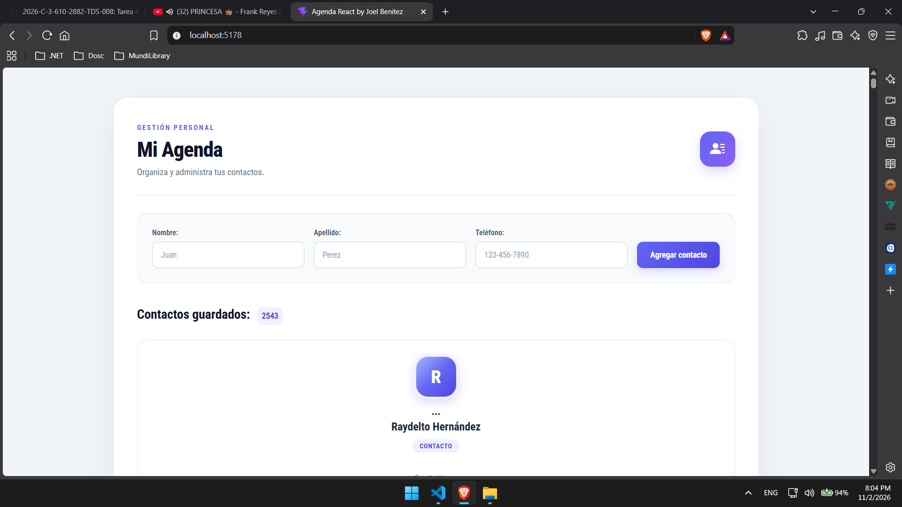
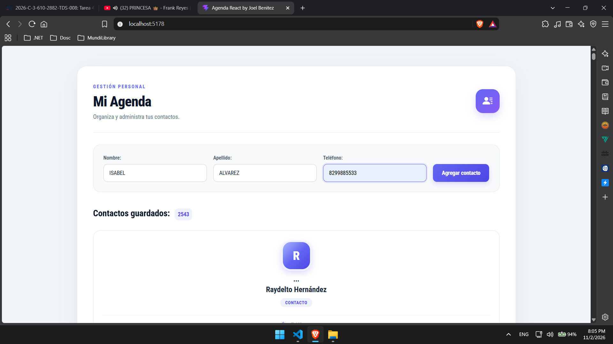
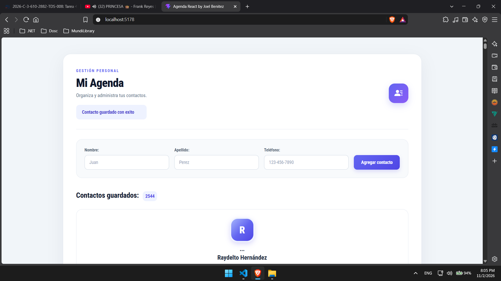
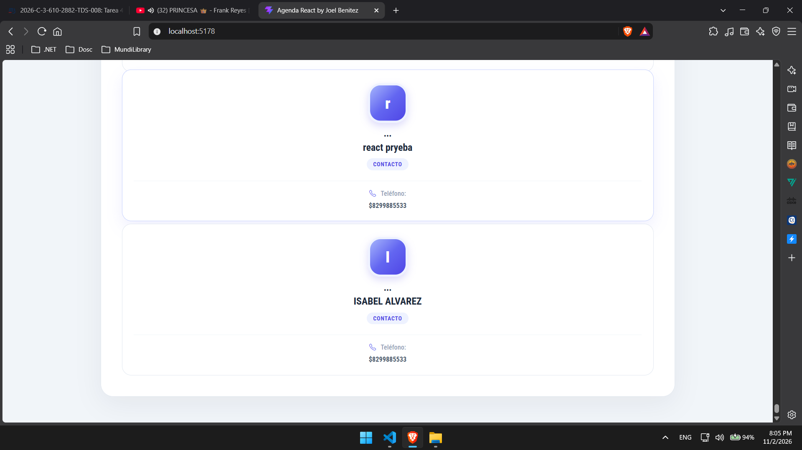

# Agenda Multicapas en React

## Información del proyecto

- **Asignatura:** Programación Web
- **Institución:** Instituto Tecnológico de las Américas (ITLA)
- **Profesor:** Raydelto Hernández Perera
- **Autor:** Joel Alberto Benítez
- **Proyecto:** Agenda de contactos desarrollada con React

## Descripción

Este proyecto consiste en el desarrollo de una agenda de contactos utilizando React. La aplicación permite consultar y registrar contactos mediante una API, mostrando la información de cada persona de forma organizada.

La interfaz está dividida en componentes para facilitar la organización y el mantenimiento del código.

## Funcionalidades

- Consultar los contactos registrados.
- Agregar nuevos contactos.
- Mostrar el nombre, apellido y teléfono de cada contacto.
- Consumir una API mediante solicitudes HTTP.
- Presentar los contactos en una interfaz organizada y adaptable.

## Tecnologías utilizadas

- React
- JavaScript
- Vite
- CSS
- API REST

## Capturas de pantallas de funcionamiento

### Apartado inicial

### Registro de contactos

### Mensaje de exito y consulta de nuevo contacto

